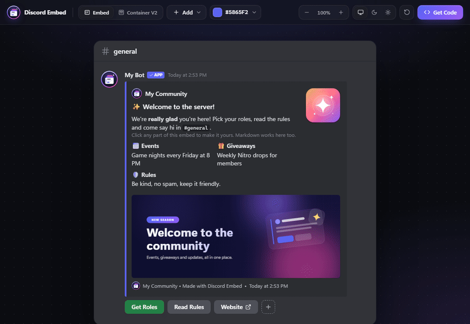
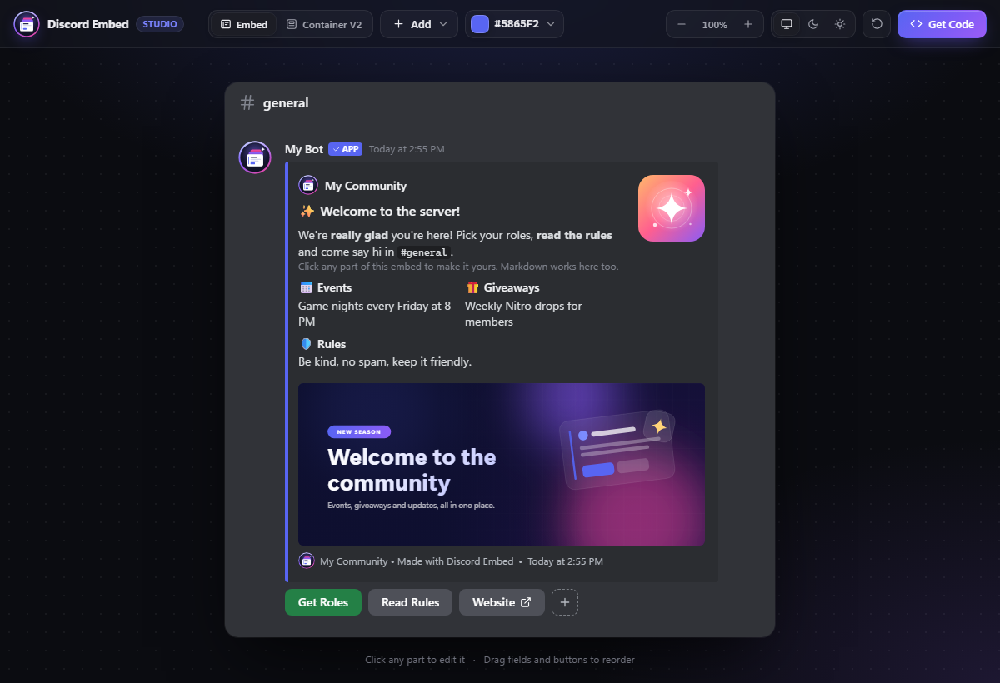
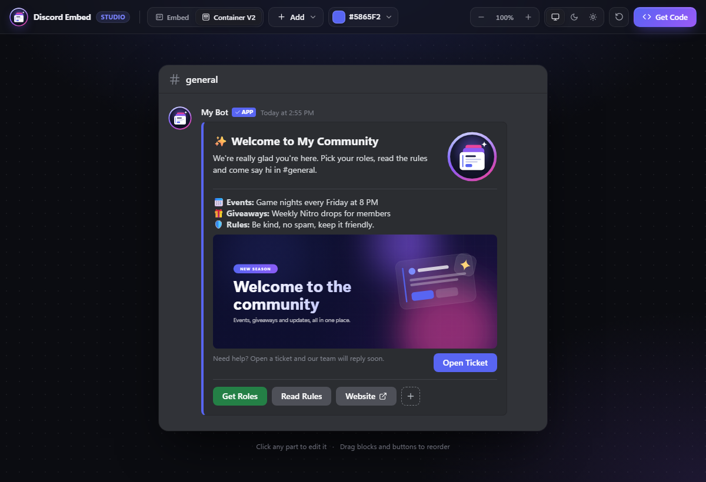
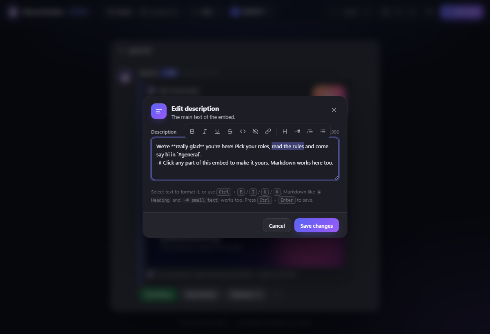
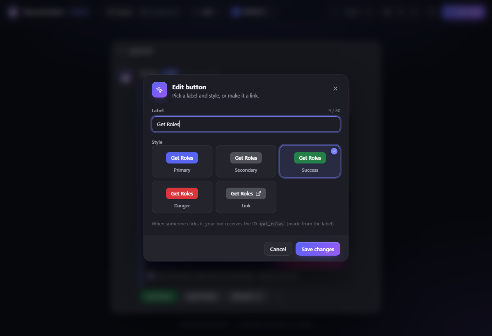
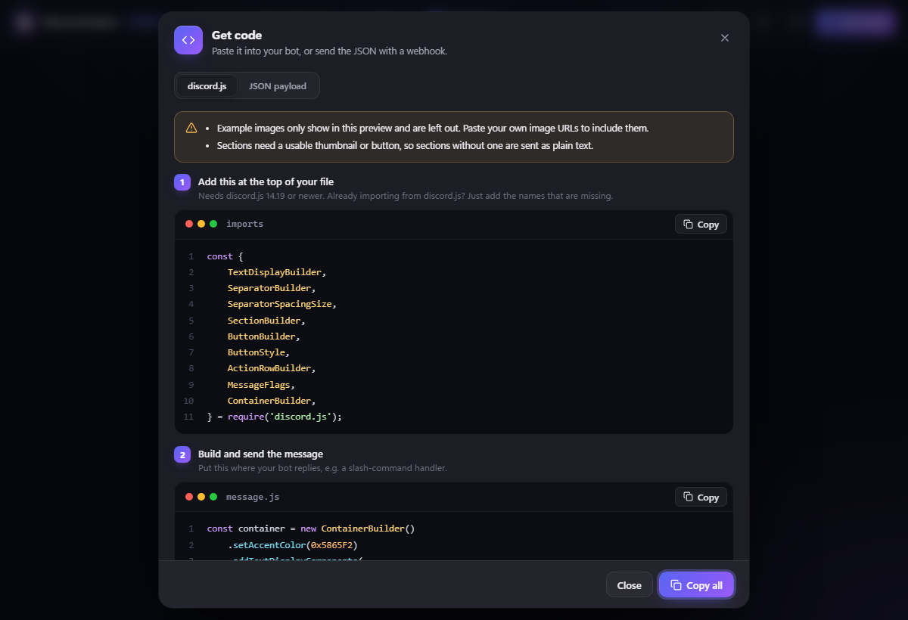
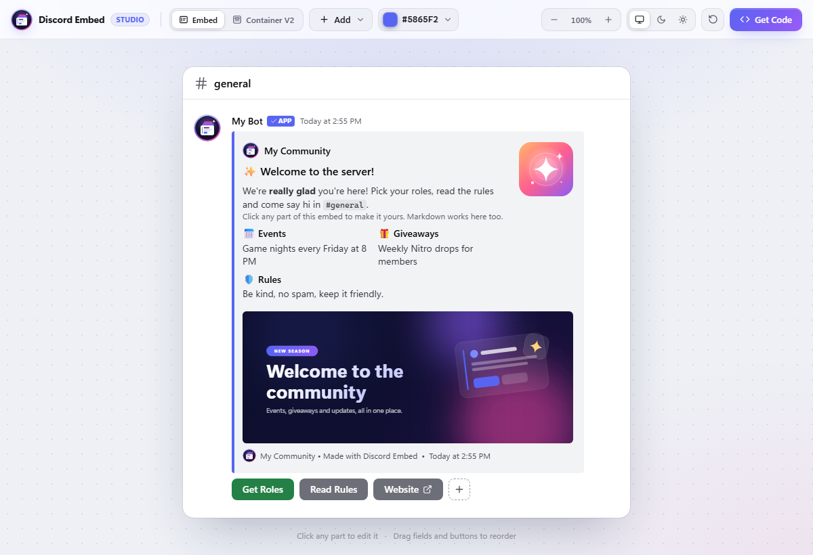

# Discord Embed

**Design Discord embeds and Components V2 messages right inside VS Code. See exactly how they will look in Discord, then copy ready-to-paste discord.js or JSON code.**

No more editing code, restarting your bot, checking Discord and doing it all again. Click, type, copy, done.

  

## Why bot developers use it

- 👀 **A preview that looks like Discord**, updated as you type
- 🧱 **Embeds and Components V2**: build classic embeds or the new containers, sections and media galleries
- ✍️ **One-click formatting**: select text and make it bold, underlined, a link and more
- 🔘 **Buttons made easy**: pick a label and a style; custom IDs are created for you
- 📋 **Code you can paste straight into your bot**, with warnings before Discord rejects anything
- 🌗 **Dark and light themes** that follow VS Code
- 💾 **Your design is saved** and is there the next time you open the editor

## Features

### A preview that looks like Discord

Click any part of the embed to edit it: author, title, description, fields, images, thumbnail, footer, timestamp and buttons. Drag fields and buttons to reorder them, and remove anything with one click. Inline fields line up the way Discord shows them.

### Components V2: containers, sections and galleries

Switch to **Container V2** to build messages with Discord's newest layout:

- **Text** with full markdown
- **Sections** with a thumbnail or a button beside the text
- **Media galleries** with up to 10 images
- **Separators** with or without a line
- **Button rows** with up to 5 buttons
- An optional **container** with an accent color, which can also be hidden as a spoiler

A counter shows how many of Discord's 40 components you have used.

### Format text in one click

Select text and a small toolbar appears above it: **bold**, *italic*, underline, strikethrough, code, spoiler and links, plus headings, small text, quotes and lists. Discord markdown shows in the preview exactly as it will in Discord.

| Shortcut | Does |
|---|---|
| `Ctrl` + `B` | Bold |
| `Ctrl` + `I` | Italic |
| `Ctrl` + `U` | Underline |
| `Ctrl` + `K` | Link |
| `Ctrl` + `Enter` | Save |

### Buttons without the busywork

Choose from all five Discord styles: Primary, Secondary, Success, Danger and Link. Custom IDs are made from the label (`Get Roles` becomes `get_roles`), so you never have to invent one. Link buttons only ask for a URL.

### Code you can paste straight into your bot

Click **Get Code** and choose:

- **discord.js**: the imports for the top of your file, plus the code that builds and sends the message
- **JSON payload**: ready for `channel.send()`, a webhook, or Discord's API

The editor checks your design against Discord's limits (title length, 25 fields, 40 components and more) and warns you before Discord would reject it.

### Dark and light themes

The preview follows your VS Code theme automatically, or you can pick dark or light yourself. Zoom in and out to check the details.

## Getting started

1. Install **Discord Embed**.
2. Click **🚀 Show Discord Embed** in the status bar, or run **Discord Embed: Show Discord Embed** from the Command Palette (`Ctrl` + `Shift` + `P`).
3. Pick **Embed** or **Container V2**, click anything to edit it, then click **Get Code**.

## FAQ

**Which discord.js version do I need?**
Embeds work with discord.js v14. Components V2 code needs discord.js 14.19 or newer.

**Why are the example images left out of my code?**
The example images ship with the extension, so Discord can't load them. Paste a public image URL (for example from your CDN or Discord) and it will be included.

**Does it send messages for me?**
No, it gives you code and JSON. Paste the code into your bot, or send the JSON with a webhook.

**Where is my design saved?**
In VS Code's storage on your computer. Use the reset button in the toolbar to start again from the example.

## Requirements

VS Code 1.93 or later.

## Support

Found a bug or have an idea? Leave a review on the Marketplace. If this extension saves you time, please give it a ⭐ rating!

See the [changelog](changelog.md) for what's new.
